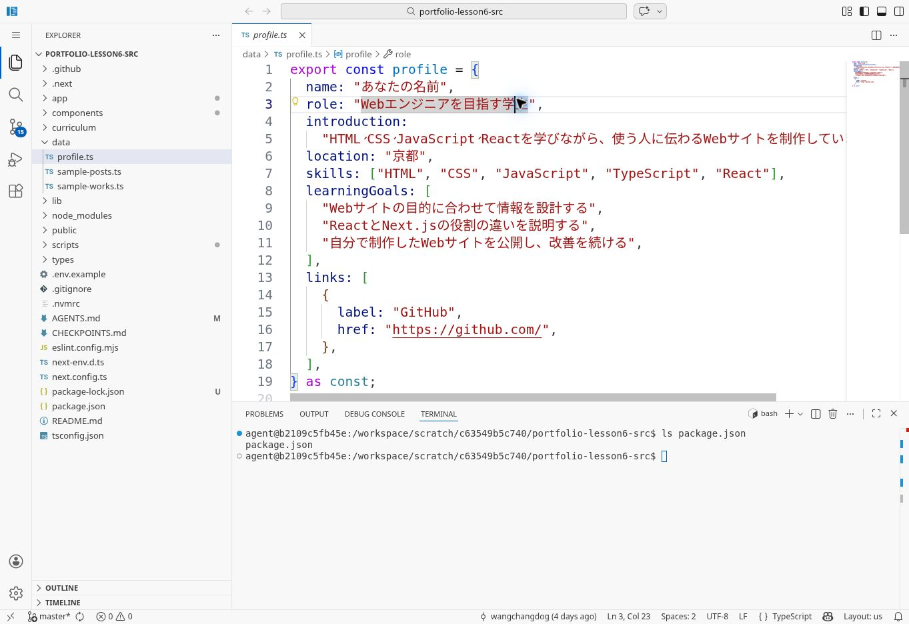
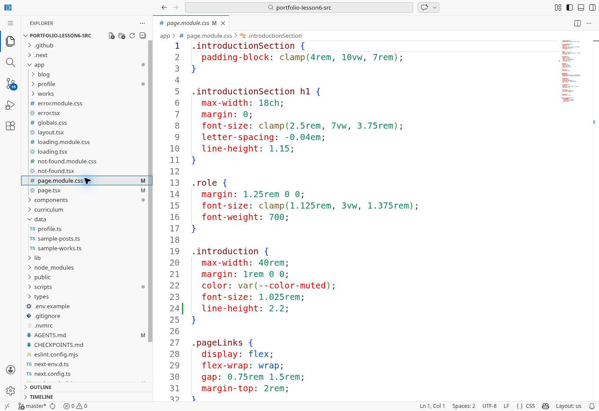
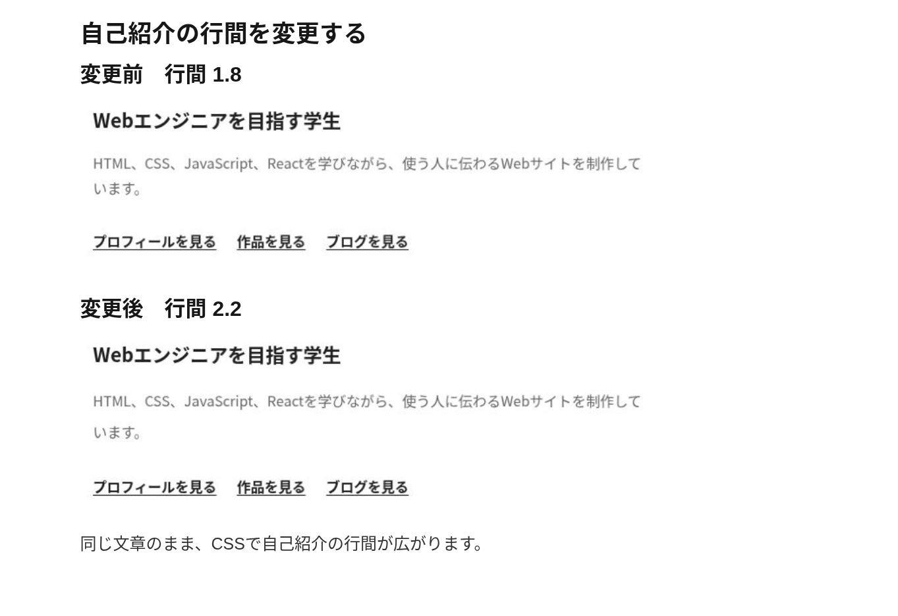
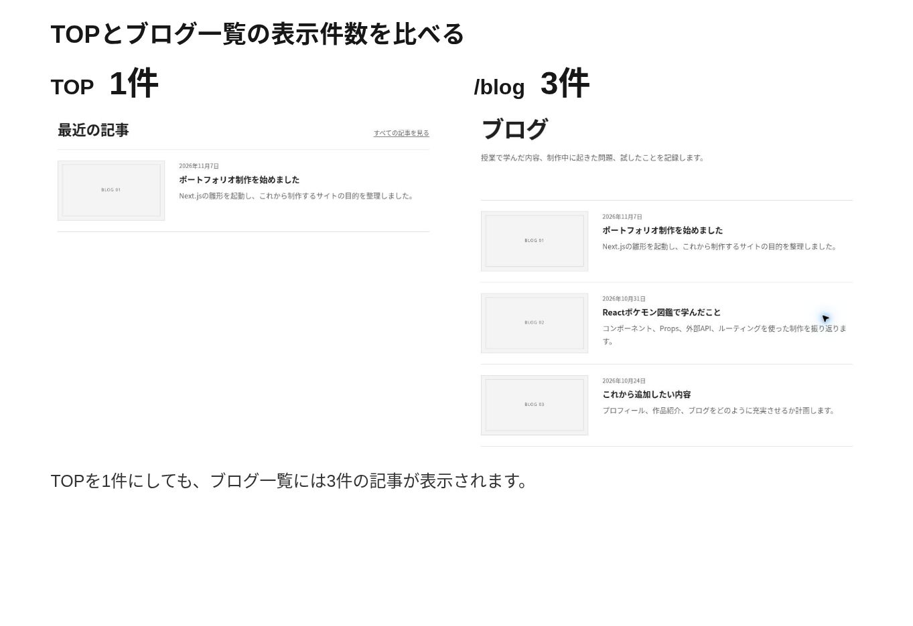
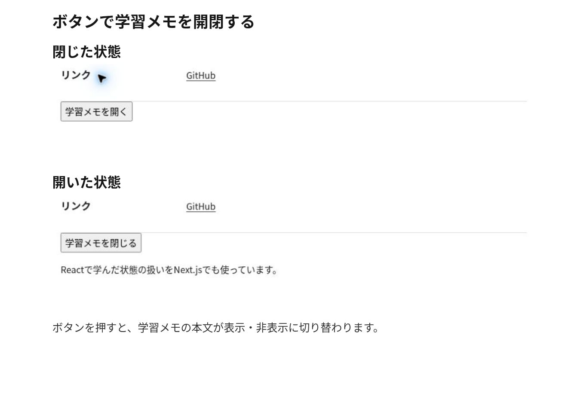

# 第5回以降の画面と設定の見方

Notionの各作業の途中で、設定画面の位置と、確認する結果を見比べるための補足です。コマンドは[COMMANDS.md](COMMANDS.md)、読む教科書の節とページは[TEXTBOOK.md](TEXTBOOK.md)で確認できます。

このページの説明図は現行教材のコードに基づいて作成しています。T05とT06には、教材を実際に動かして撮影した画面も掲載しています。T06の比較図は、実画面の確認する部分を抜き出して並べたものです。管理画面の画像は公式資料の画面例です。画像ごとに確認する箇所と出典を記載しています。画像が小さい場合は、画像を開いて拡大してください。

## T05：どのフォルダで、何を実行するか

初回のcloneは制作フォルダを置く親フォルダで実行します。取得後は、VS Codeで`react-next-portfolio`を開き直します。`pwd`の末尾がこの名前で、`ls package.json`に`package.json`が表示されれば、そこで`npm run dev`を実行できます。

`origin`は自分のGitHub、`course`は配布元です。別のPCで続きを始めるときは、自分の`origin`に保存したコードをcloneします。[初回と再開の分岐](COMMANDS.md#resume)を使ってください。

### GitHubの空のリポジトリを作る

| 作成画面で確認する項目 | この課題の設定 |
| --- | --- |
| Owner | 自分のGitHubアカウント |
| Repository name | `react-next-portfolio` |
| Visibility | Public |
| Add README | 追加しない |
| Add .gitignore | 追加しない |
| Choose a license | この作成時点では追加しない |

作成後、URLのアカウント名が自分のものであることを確認します。保存済みのリポジトリがある場合は、そのリポジトリから再開します。

### 文章を書き換えたときの確認

左のファイル一覧で`data/profile.ts`を開くと、中央に名前や自己紹介のコードが表示されます。下の「TERMINAL」では、`ls package.json`の結果に`package.json`が表示されていることを確認できます。OpenVSCode Serverの撮影用フォルダは`portfolio-lesson6-src`ですが、授業では自分の`react-next-portfolio`を開き、`main`で作業します。

| 編集する場所 | ブラウザで開く場所 | 確認する変化 |
| --- | --- | --- |
| `data/profile.ts`の`name` | TOPと`/profile` | 両方に自分の名前が表示される |
| 同ファイルの`introduction` | TOPと`/profile` | 両方の自己紹介文が変わる |
| `components/SiteHeader.tsx`の`Link` | ヘッダーの各リンク | `href`に書かれたページへ移動できる |

最初は引用符内の文章を一つ変えて保存し、画面を確認します。ターミナルが示したポート番号が3000以外なら、そのURLを使います。

## T06：データと見た目の変化を確認する

### T06-1：自己紹介の行間を変える

`app/page.tsx`の自己紹介には`className={styles.introduction}`が付いており、`app/page.module.css`の`.introduction`が対応します。初期状態ではこのブロックに`line-height`がなく、`app/globals.css`の`body`にある`line-height: 1.8`を継承しています。

既存の`.introduction`のブロック内へ`line-height: 2.2;`を1行追加して保存します。TOPの自己紹介文の行間が広がることを、同じ画面幅で確認してください。プロフィールページは別のCSS Modulesを使うため、この変更の対象はTOPの自己紹介です。

画像の24行目が追加した1行です。左の`app/page.module.css`と、中央の`.introduction`を確認します。ここでも撮影用フォルダ名は`portfolio-lesson6-src`です。

元の実画面：[変更前のTOP](images/t06-css-before.jpg)／[変更後のTOP](images/t06-css-after.jpg)。

### T06-2・3：データ、表示件数、部品の関係を見る

この図は、サンプル記事が3件あり、TOPの`slice(0, 3)`を一時的に`slice(0, 1)`へ変更した状態です。TOPの「最近の記事」は1件、`/blog`は3件になります。CMS接続後は、CMSにある公開記事の件数で同じ関係を確認します。

次の比較図では、TOPの「最近の記事」とブログ一覧の件数を見比べます。自分のサイトでも、TOPは1件、ブログ一覧は3件であることを確認してください。各ページの`posts.map`が、表示する記事を1件ずつ`PostCard`の`post`へ渡しています。

元の実画面：[TOPの最近の記事](images/t06-top-one-post.jpg)／[ブログ一覧](images/t06-blog-three-posts.jpg)。

| 操作 | 期待する結果 |
| --- | --- |
| TOPに表示しているサンプル記事の`title`を変更する | TOPとブログ一覧の両方で、その記事のタイトルが変わる |
| TOPだけを`slice(0, 1)`にする | TOPの記事数だけが1件になる |

### T06-4：画像の変更を確認する

`thumbnail.url`と元画像の幅・高さを変更したら、一覧とその記事の詳細を開き、両方で画像が変わることを確認します。

### T06-5：学習メモの開閉を確認する

`LearningNote`は、コンポーネントのファイルを作る、プロフィールへimportする、`<LearningNote />`を配置する、という3か所の変更で表示できます。閉じた状態と開いた状態の両方を確認します。

プロフィールページの下部でボタンを押します。`open`が`false`のときは本文が隠れ、`true`になると本文と「学習メモを閉じる」の表示を確認できます。もう一度押して、閉じた状態へ戻ることも確かめます。

元の実画面：[閉じた状態](images/t06-learning-note-closed.jpg)／[開いた状態](images/t06-learning-note-open.jpg)。

実画面の撮影条件

T05とT06の実画面は、2026年11月12日に[教材のコミット1760268](https://github.com/wangchangdog/react-next-portfolio-2026/commit/1760268a822412a51aae7547b58cc5b7ad4ca5db)から作った作業コピーを使って撮影しました。アプリはサンプルデータで実行し、比較のため、T06-1の`line-height: 2.2`、T06-2のTOPの`slice(0, 1)`、T06-5の`LearningNote`を順に追加しています。`LearningNote`はNotion掲載のコードを使い、独自のCSSは追加していません。

元の実画面8枚は撮影したファイルのまま保存しています。比較図3枚は、その画像の一部をHTMLとCSSで抜き出して並べ、ブラウザで撮影したものです。元画面の内容は書き換えていません。[比較図の再現方法](comparison-pages/README.md)も参照できます。

## T08：microCMSの管理画面で設定する

### 1. API作成画面を開く

自分のサービスを開き、左の「コンテンツ（API）」の「…」から「新しいAPIを作成」を選びます。名前・エンドポイントを指定する手順へ進みます。

公式画面例：左の「コンテンツ（API）」の「…」から「新しいAPIを作成」を選びます。サービス名は自分のものに読み替えてください。 出典：[公式資料](https://document.microcms.io/manual/create-api)。

### 2. API名とエンドポイントを入力する

公式画面例：入力欄の位置を確認します。教材ではAPI名を「ブログ」、エンドポイントを blogs にします。作品では「作品」と works に読み替えます。 出典：[公式資料](https://document.microcms.io/manual/create-api)。

| 作るAPI | API名 | エンドポイント |
| --- | --- | --- |
| ブログ | ブログ | `blogs` |
| 作品 | 作品 | `works` |

API名は管理画面で見分ける表示名です。コードが取得先を指定するときはエンドポイントを使います。URL全体をエンドポイントへ入力せず、上の英字だけを設定します。

### 3. リスト形式を選ぶ

公式画面例：ブログも作品も「リスト形式」を選びます。選択された側の枠を確認してから次へ進みます。 出典：[公式資料](https://document.microcms.io/manual/create-api)。

ブログも作品も、複数の内容を保存できる「リスト形式」を選びます。

### 4. 4つのフィールドを設定する

公式画面例：項目を追加する位置を確認します。教材のフィールドIDは title・description・content・thumbnail の4つで、必須をONにするのは title だけです。画像の body は使いません。 出典：[公式資料](https://document.microcms.io/manual/create-api)。

上の公式画像は入力欄の位置を確認するために使います。この教材では、次の4項目を作ります。設定後はフィールドID・種類・必須設定を1行ずつ見比べます。

| フィールドID | 表示名の例 | 種類 | 必須 |
| --- | --- | --- | --- |
| `title` | タイトル | テキストフィールド | ON |
| `description` | 概要 | テキストエリア | OFF |
| `content` | 本文 | リッチエディタ | OFF |
| `thumbnail` | サムネイル | 画像 | OFF |

公式画像の`body`に当たる項目を、教材では`content`にします。`id`や日時はmicroCMSが管理するため、追加するフィールドは上の4つです。作成を確定したら、ブログ記事2件と作品1件を入力して公開します。

### 5. APIプレビューで公開した内容を確認する

コンテンツの一覧から「APIプレビュー」を開きます。GETを選び、ブログは取得先の末尾が`/blogs`、作品は`/works`であることを確認して「取得」を押します。

公式画面例：GETと取得先の blogs を確認して「取得」を押します。作品は works に読み替えます。返ってきた contents で自分の記事を確認してください。 出典：[公式資料](https://document.microcms.io/manual/api-preview)。

一覧取得の結果には`contents`という配列があります。ブログ2件を公開した場合は、配列内の2件の`id`・`title`を管理画面と見比べます。画像を設定した記事の`thumbnail`には、画像の`url`・`width`・`height`が含まれます。

この段階で見るのはAPIの応答です。画面右側のJavaScript例を教材へ貼り付ける作業はありません。サイトの取得処理はT09の手順で変更します。

### 6. 公開サイト用のGET権限を確認する

サービスのサイドバーにあるAPIキーの項目から、使うキーを開きます。既存キーがある場合はその権限を確認します。新しいキーを作れる数はプランによって異なるため、常に追加作成する必要はありません。

公式画面例：コンテンツAPIのGET権限を確認します。教材では書き込み権限と下書き・公開終了の全取得を付けません。権限表を横にスクロールし、右側の項目も確認してください。 出典：[公式資料](https://document.microcms.io/content-api/x-microcms-api-key)。

`blogs`と`works`にGET権限があることを確認します。POST・PUT・PATCH・DELETE、および下書き・公開終了コンテンツの全取得は、この標準課題では有効にしません。権限表の右側が隠れている場合は、横スクロールして確認します。実キーの値が映った画面を提出する作業はありません。

### 7. PCに設定を保存し、接続を確認する

`.env.local`は`package.json`と同じ場所に作ります。サービスIDには、例えば管理画面のドメインが`example.microcms.io`なら`example`だけを入力します。実キーは`MICROCMS_API_KEY`の値へ設定します。

接続コマンドと結果の読み方は[接続設定と確認](COMMANDS.md#cms)を使います。説明図の成功表示は出力の例です。自分のサービスで実行し、両APIの接続と公開件数を確かめてください。

## T09・T10：一覧と詳細を順に接続する

| 段階 | 編集・確認する場所 | 完了時の確認 |
| --- | --- | --- |
| T08 | `.env.local`、接続確認スクリプト | `blogs`と`works`の接続が成功する。サイトの表示はサンプルのままでよい |
| T09：ブログ | `lib/posts.ts`の一覧取得、`/blog`とTOP | CMSで公開したタイトル・概要・画像が一覧に出る |
| T09：作品 | `lib/works.ts`の一覧取得、`/works`とTOP | CMSで公開した作品が一覧に出る |
| T10：ブログ | ブログの1件取得、`/blog/コンテンツID` | その記事のタイトル・本文・画像が出る |
| T10：作品 | 作品の1件取得、`/works/コンテンツID` | その作品のタイトル・本文・画像が出る |
| T10：存在しないID | 上記のURLのID部分を一時的に変更 | Not Foundになる。正しいIDへ戻すと内容が出る |

`/blog/コンテンツID`の「コンテンツID」は、自分のmicroCMSに表示されたIDへ置き換えます。教材の`[slug]`というフォルダ名は、ここに入る可変の値を受け取るための名前です。

T09時点ではCMSの詳細取得が未実装なので、一覧からクリックするとNot Foundになる場合があります。一覧の確認を終えたらT10で詳細へ進みます。実装例は[steps](steps/)にあります。

## T11：Vercelに設定して、公開後の変更を確認する

自分のGitHubの`react-next-portfolio`をImportします。配布元を選ばず、公開に使う自分の`main`を確認します。Framework PresetはNext.js、Root Directoryは`package.json`があるリポジトリ直下、Node.jsは24系です。

### 環境変数を追加する

初回はImport後の設定画面で、Deployの前に環境変数を追加します。作成済みのプロジェクトでは「Environment Variables」を開きます。少なくともProductionを対象にして、次の3つを設定します。

| 名前 | 値 | 種類を選ぶ画面の場合 |
| --- | --- | --- |
| `MICROCMS_SERVICE_DOMAIN` | 自分のサービスID | Config |
| `MICROCMS_API_KEY` | 自分のGET専用キー | Secret |
| `NEXT_PUBLIC_SITE_URL` | 自分の本番URL | Config |

公式画面例（2026年8月更新）：MICROCMS_API_KEYはSecret、MICROCMS_SERVICE_DOMAINとNEXT_PUBLIC_SITE_URLはConfigを選びます。Key・Value・Productionを確認して保存してください。画像のCLIENT_KEY…は入力例です。公開後に値を変更した場合は再デプロイします。 出典：[公式資料](https://vercel.com/changelog/environment-variables-now-use-config-and-secret-types)。

Vercelでは2026年8月からConfigとSecretの選択へ移行しています。Secretは保存後の値を閲覧できませんが、デプロイからは利用できます。[型の変更についての公式説明](https://vercel.com/changelog/environment-variables-now-use-config-and-secret-types)を参照できます。

初回で本番URLがまだ分からない場合は、授業手順どおり`NEXT_PUBLIC_SITE_URL`を`http://localhost:3000`で設定して公開し、確定した自分の本番URLへ変更して再デプロイします。公開URLを登録する前に、この更新まで確認します。

### 登録済みの変数を変更する

「Environment Variables」の検索欄で、変更する変数名（例：`NEXT_PUBLIC_SITE_URL`）を探します。対象行の「…」から「Edit」を選び、値を編集して「Save」で保存します。画面に示された適用環境も確認してください。

変数名とProductionの設定を確かめて保存します。続いてプロジェクトの「Deployments」を開き、対象デプロイのメニューから「Redeploy」を選びます。再デプロイが成功した後、本番URLで一覧・詳細を確認します。[再デプロイの公式手順](https://vercel.com/docs/deployments/managing-deployments#redeploy-a-project)でも操作を確認できます。

### 変更内容に合わせて反映する

公開後、CMSの記事のタイトルと本文を一時的に変更して公開し、本番サイトの一覧と詳細をそれぞれ再読み込みします。変更が両方に反映されたら、確認用の文章を元へ戻して公開し、戻った状態も確かめます。コードの保存・環境変数の変更・CMSの記事更新を混同せず、図の操作を使ってください。

## T12〜T15：公開した状態で仕上げる

T12では、公開URLで狭い画面幅、画像、キーボード操作、タイトル・説明文を確認します。T13以降は、必須要件に残りがあればその箇所へ戻り、完了した場合は文章・作品・デザインの改善や発展課題を選びます。

コードや画像ファイルを編集した場合は、[保存手順](COMMANDS.md#save)でGitHubへpushし、対応するVercelのデプロイが成功した後、本番URLで確認します。CMSの内容だけを編集した場合は、microCMSで公開し、対象ページを再読み込みします。

T14の最終確認とT15の相互フィードバックでは、登録済みのリポジトリURL・公開URL・READMEが現在の制作物と一致しているかを確認します。要件・評価期限・提出の運用は、Notionの各回と期末課題ページに従います。

## 図版の出典と更新

公式画像のURL、出典、教材と異なる値は[official-images.json](images/official-images.json)で管理しています。説明図の再生成には`images/render_diagrams.py`、Pillow、日本語のOpenTypeフォントを使用します。図版の作成は教員側の保守作業であり、学生が実行する手順には含めません。
